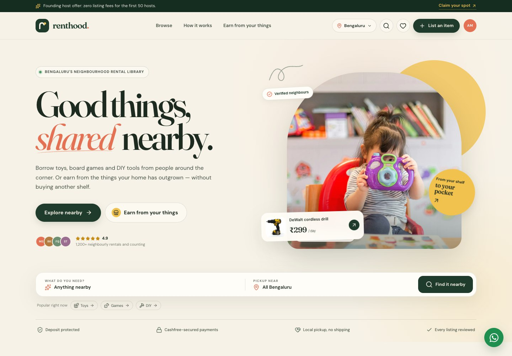

# RentHood

**Good things, shared nearby.** A neighbourhood rental marketplace for Bengaluru
with three deliberately curated categories: **Kids Toys**, **Board Games** and
**Low-value DIY & Tools** (hammers, drills and small repair kits).

People can list things they already own, earn from them, and borrow from
neighbours. Bookings, refundable deposits and host payouts are designed around
**Cashfree Payments**, and every handover can be coordinated through a
prefilled **WhatsApp** message.



## What works in this build

- **Curated marketplace** — browse, search and filter 10 seeded listings across
  the three supported categories.
- **Product pages** — availability dates, live price breakdown, deposit,
  owner profile, reviews, pickup notes and a WhatsApp enquiry link.
- **Cashfree checkout** — server-created orders with a Cashfree sandbox demo
  fallback when API keys are not configured. Demo payments complete the full
  booking flow without charging money.
- **List & earn flow** — 3-step listing wizard with category restriction,
  description, photo upload (optimised in-browser), price/deposit, earnings
  estimate, live card preview and WhatsApp listing handoff.
- **Host dashboard** — earnings chart, next pickup, recent rentals, listings,
  bookings, payouts and saved items.
- **WhatsApp links** — prefilled messages for listing an item, asking a host a
  question, or coordinating a confirmed pickup. No WhatsApp Business API account
  is required for these links.
- **PWA** — web app manifest, app icons, service worker and offline app-shell
  caching.
- **Responsive UI** — custom mobile navigation, filter bottom sheet, sticky
  booking card on desktop and a full-width booking-first layout on mobile.
- **Durable API persistence** — with Supabase configured, listing metadata,
  uploaded photo URLs, demo orders and bookings are stored in Postgres/Storage.
  Without it, the Express server falls back to `server/db.json` for local work.

Demo account: **Aarav Mehta** (`aarav.mehta@example.com`). No authentication is
implemented — this is a front-end/product prototype, not a production identity
system.

---

### Preview

| Desktop listing | Mobile checkout |
| --- | --- |
|  |  |

## Durable storage on Render (recommended)

The current Render service can keep user listings and images across restarts and
deploys by using **Supabase free tier**:

- **Postgres** stores one small JSONB state document (`renthood_state.data`)
  containing listing metadata, orders and bookings.
- **Supabase Storage** stores the listing photos in a public
  `renthood-listing-images` bucket. Only the resulting public URL is stored in the
  database.
- Uploaded images are optimised in the browser before upload (max width 1200px);
  the server rejects files over 5 MB and accepts JPEG/PNG/WebP.
- The service-role key stays server-side on Render. It is never sent to the
  browser.

Supabase's free tier is the cheapest practical option here because it includes
both a database and object storage in one project. Free-tier limits apply (at the
time of writing: 500 MB database and 1 GB file storage). For high image volume,
the next step is Cloudflare R2 (10 GB free) + Neon/Postgres for metadata.

### Set it up

1. Create a free project at [supabase.com](https://supabase.com).
2. Open **SQL Editor** and run [`supabase/schema.sql`](supabase/schema.sql).
   This creates the state table, the public image bucket, the public-read policy
   and an initial empty state row.
3. Copy the **Project URL** and **service_role** secret from
   **Project Settings → API**.
4. Add these environment variables in Render → your service → Environment:
   - `SUPABASE_URL` — e.g. `https://xxxx.supabase.co`
   - `SUPABASE_SERVICE_ROLE_KEY` — the service_role key (server only)
   - `SUPABASE_BUCKET` — `renthood-listing-images`
   - `VITE_WHATSAPP_NUMBER` — `919148738996`
   - `PUBLIC_APP_URL` — `https://renthood.onrender.com`
5. Redeploy the service after pushing the new code.
6. Check `https://renthood.onrender.com/api/health`. It should return:

```json
{
  "ok": true,
  "storage": {
    "metadata": "supabase-postgres",
    "images": "supabase-storage:renthood-listing-images"
  }
}
```

If it still says `local-json`, the environment variables are missing or the
Render deploy has not picked them up. A JSONB state document is intentionally
simple for a beta; split it into normalised tables when listing volume or
concurrent write volume grows.

The repo also includes [`render.yaml`](render.yaml) for a Blueprint-style
deploy, though you can add the environment variables to the existing service
instead.

> **Note on the existing Render deployment:** the public URL is currently
> running the initial prototype commit. Push the latest `main` branch (or let
> Render auto-deploy it) after adding the Supabase variables. The workspace could
> not push to GitHub because it does not have your GitHub credentials.

## Cloud MVP (Vercel, free tier)

This repo is Vercel-ready:

- Vite frontend is built into `dist/`.
- API routes live in `api/*.js` and run as Vercel Functions.
- Shared marketplace state is stored in a **private Vercel Blob** JSON document,
  so listings and bookings survive across users and serverless instances.
- Cashfree runs in **demo/sandbox mode** unless merchant keys are configured;
  testers can complete bookings without any real payment.
- `server/index.mjs` remains the local Express server for development; the
  production Vercel path uses the same pricing and validation rules.

### Deploy

```bash
npx vercel login
npx vercel link --yes --project renthood-mvp

# Create and connect a free private Blob store for shared state
npx vercel blob create-store renthood-state --access private --yes \
  --environment production --environment preview

# Optional: configure WhatsApp and public app URL
npx vercel env add VITE_WHATSAPP_NUMBER production   # 919148738996
npx vercel env add PUBLIC_APP_URL production         # https://your-deployment.vercel.app

npx vercel --prod
```

If the Blob store is missing, the API falls back to process memory: fine for a
single local demo, **not** fine for multi-user testing. Check the deployed
`/api/health` response for `"persistence": "vercel-blob"`.

The app is deliberately auth-free for this MVP. Anyone with the link can browse,
list and use the demo host dashboard. Treat it as a closed beta link, not a
production marketplace.

## Run locally

```bash
npm install
cp .env.example .env
npm run dev
```

- Web app: <http://localhost:5173>
- API: <http://localhost:8787>
- Health check: <http://localhost:8787/api/health>

`npm run dev` starts Vite and the Express API together. Vite proxies `/api` to
port `8787`.

### Production build

```bash
npm run build
npm start
```

`npm start` serves the API and the built `dist/` folder on
<http://localhost:8787>. Set `PORT` and `PUBLIC_APP_URL` for your deployment.
The Vercel serverless API lives separately under `api/` and is used when deployed
to Vercel.

---

## Cashfree setup

Cashfree keys are **server-side only** and must never be exposed through Vite
(`VITE_*`) variables.

1. Create a merchant account at
   [Cashfree Payments](https://www.cashfree.com/payment-gateway-india/).
2. Create API keys in the Cashfree dashboard.
3. Add them to `.env`:

```env
CASHFREE_APP_ID=your_app_id
CASHFREE_SECRET_KEY=your_secret_key
CASHFREE_ENV=sandbox
PUBLIC_APP_URL=http://localhost:5173
```

4. Restart the API. The checkout now creates a real Cashfree order through
   `POST /api/create-order` and opens the Cashfree JS SDK v3 checkout.
5. After payment, Cashfree returns to `/checkout/return?order_id=...`. The app
   calls `GET /api/verify-order`, verifies the order server-side and confirms the
   booking.

Without keys the server returns `mode: "demo"` and the UI runs a clearly labelled
sandbox payment sheet. **No money is charged in demo mode.**

Relevant server routes:

| Route | Purpose |
| --- | --- |
| `GET /api/listings` | Seeded + locally created listings |
| `POST /api/listings` | Validate and persist a new listing |
| `POST /api/create-order` | Price a rental and create a Cashfree / demo order |
| `POST /api/confirm-order` | Confirm a demo order (blocked for live orders) |
| `GET /api/verify-order?orderId=` | Verify a live Cashfree payment and create the booking |
| `GET /api/bookings` | Stored bookings |
| `GET /api/config` | Cashfree mode + WhatsApp number |

For production, add a **Cashfree webhook** endpoint and verify the signature
before marking an order as paid. Do not rely only on the browser return URL.
Also move deposit handling to a Cashfree-verified payout/refund workflow.

---

## WhatsApp setup

Set your support/host number in `.env` (international format, digits only):

```env
VITE_WHATSAPP_NUMBER=919148738996
```

The number is used to build `wa.me` links from:

- the floating “List on WhatsApp” button
- the listing wizard
- product enquiry buttons
- the booking confirmation screen
- the footer help link

The current implementation opens a chat with a prefilled message. For
automated WhatsApp notifications (booking created, return reminder, payout
sent), connect the WhatsApp Cloud API or a provider such as Twilio/Gupshup.

---

## Project structure

```text
shared/
  categories.json        # The only three categories
  listings.json          # Seed catalogue + host demo content
server/
  index.mjs              # Express API, Cashfree orders, verification
  persistence.mjs        # Supabase Postgres/Storage adapter + local JSON fallback
  vercel/                # Shared Vercel serverless core
  db.json                # Local fallback (gitignored)
supabase/
  schema.sql             # Durable state table + renthood-listing-images bucket
render.yaml              # Render blueprint with env placeholders
src/
  components/            # Header, cards, checkout modal, calculator, navigation
  pages/                 # Home, Browse, ListingDetail, ListItem, Dashboard,
                         # CheckoutReturn, NotFound
  store.tsx              # Listing, wishlist, booking and toast state
  lib.ts                 # Pricing, dates, image optimisation, WhatsApp helpers
  index.css              # Design system + responsive layout
public/
  images/                # Optimised local WebP photography
  manifest.webmanifest
  sw.js
  icon-192.png / icon-512.png
```

---

## Product rules

- Only **three categories** can be listed or borrowed: Kids Toys, Board Games,
  and DIY & Tools. The API and UI both enforce this.
- Daily rent + a refundable deposit is charged at checkout.
- RentHood's renter service fee is 6% (minimum ₹19); the host success fee is 10%.
- The deposit is refundable after the item is returned. In production this
  should be backed by a proper escrow/refund workflow.

## Before going live

This prototype intentionally ships without:

- Authentication, phone OTP and KYC verification
- A production database (SQLite/Postgres) and object storage for photos
- Cashfree webhook signature verification, refunds and payout KYC
- Real-time availability calendars / double-booking prevention
- Normalised SQL tables instead of the beta JSONB state document
- Image moderation and orphaned-image cleanup
- Dispute resolution, damage cover and insurance
- Admin moderation queue for new listings

Those are the next engineering milestones; the UI and API boundaries are in
place to add them without redesigning the experience.
